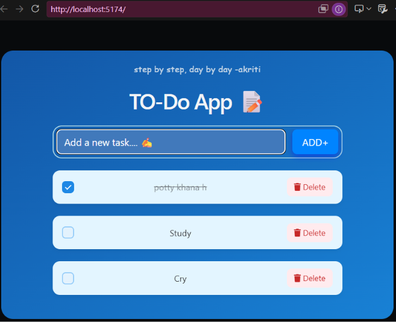

# 📝 React ToDoApp

As moving forward with react I wanted to level up my skills with **state lifting**, **array manipulation**, and **component communication**, so I built this **Pastel Blue To-Do App** (`akriti`) using React, Vite, Bootstrap 6, and CSS Modules!

## 📸 Preview



---

## ✨ Features

* **Add Tasks Easily:** Type a task and click **`ADD+`** (or just hit `Enter`) to add it to your list—empty tasks are automatically prevented.
* **Interactive Custom Checkboxes:** Mark tasks as completed with a smooth strike-through effect and custom blue checkmark styling.
* **Instant Task Deletion:** Remove tasks cleanly with a single click using `.filter()`.
* **Aligned Pastel Blue UI:** Designed with a calm sky-blue palette, motivational header quote, and consistent card alignment.

---

## 🧠 What I Learned & Practiced

1. **Lifting State Up (`App.jsx`):** Kept the master `todoList` array in `App.jsx` and passed callback functions (`onAdd`, `onDelete`, `onToggle`) down to `Header` and `AddTodo`.
2. **Array State Updates:** Practiced immutable state updates in React using the spread operator (`[...todoList, newTodo]`), `.map()` for toggling completion, and `.filter()` for deleting items.
3. **Controlled Inputs (`useState`):** Managed live input typing and automatic input clearing inside `Header.jsx`.
4. **Scoped Styling + Bootstrap 6:** Combined Bootstrap 6 utility classes with CSS Modules (`.module.css`) for custom checkboxes and responsive layout alignment.

---

## 🛠️ Tech Stack

* **Frontend:** React.js (Vite)
* **Styling:** Bootstrap 6 (alpha), CSS Modules, Flexbox
* **Icons & Fonts:** FontAwesome, Google Fonts (`Pacifico`)

---

## 🚀 How to Run Locally

```bash
git clone [https://github.com/Akriti369/react-TodoApp.git](https://github.com/Akriti369/react-TodoApp.git)
cd react-TodoApp
npm install
npm run dev
